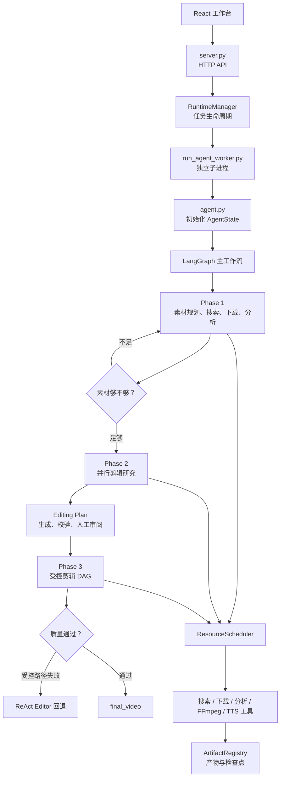

想快速理清这个项目，不要从 6000 多行的 `script/graph.py` 第一行开始读。最有效的方法是追踪“一条请求如何变成视频”，并把系统分成四层。

## 一、先建立整体模型



最关键的理解是：

- `LangGraph`：决定业务阶段往哪里走。
- `ResourceScheduler`：决定一个阶段内部哪些任务可以并行。
- `Tools`：真正执行下载、分析、剪辑、TTS、字幕和导出。
- `RuntimeManager`：管理任务、子进程、取消、恢复和事件。
- `ArtifactRegistry`：管理中间文件和最终成片。

## 二、按调用链阅读

### 第一步：看请求如何进入系统

从 [run_backend.py](D:/Crayotter-main/script/run_backend.py:1) 开始，它只是后端启动入口。

接着看：

1. [server.py](D:/Crayotter-main/app/backend/server.py:44)
   - `do_GET()`：查询任务、事件、产物和配置。
   - `do_POST()`：创建、取消和恢复任务。

2. [RuntimeManager.create_job](D:/Crayotter-main/app/backend/runtime_manager.py:247)
   - 创建 `job_id`。
   - 建立独立任务目录。
   - 保存任务配置。
   - 启动后台线程。

3. [RuntimeManager._run_job](D:/Crayotter-main/app/backend/runtime_manager.py:543)
   - `demo` 模式执行模拟流程。
   - `agent` 模式启动真正的 Agent 子进程。

4. [run_agent_worker.py](D:/Crayotter-main/script/run_agent_worker.py:79)
   - 读取任务和运行配置。
   - 调用 `agent.run_task()`。
   - 将 Agent 事件通过 stdout 传回后端。

这一段解决的是：

> Web 请求如何变成一个隔离运行的 Agent 任务？

### 第二步：看 Agent 如何启动 LangGraph

重点看 [agent.run_task](D:/Crayotter-main/script/agent.py:1118)。

核心逻辑可以简化成：

```python
graph = build_graph()

initial_state = AgentState(
    user_request=task,
    processing_budget=...
)

for step_output in graph.stream(initial_state):
    保存节点状态
    发送运行事件
```

这里主要做四件事：

1. 读取用户需求。
2. 创建初始 `AgentState`。
3. 构建 LangGraph。
4. 通过 `graph.stream()` 逐节点执行。

接着读 [AgentState](D:/Crayotter-main/script/workflow/state.py:48)，重点理解这些字段：

- `user_request`：当前用户需求。
- `phase`：当前阶段。
- `plan`：Phase 1 素材计划。
- `step_results`：已执行步骤。
- `material_gap_report`：素材缺口报告。
- `editing_blueprint`：剪辑蓝图。
- `final_output`：最终结果。
- `processing_budget`：任务时间预算。

`AgentState` 就是所有 Agent 角色共享的“工作记忆”。

## 三、先看拓扑，不要先看节点实现

打开 [workflow/topology.py](D:/Crayotter-main/script/workflow/topology.py:41)。

这里最清楚地展示了节点关系：

```text
START
  ↓
steering_entry
  ↓
planner
  ↓
phase1_scheduler
  ↓
material_gap_evaluator
  ├─ supplement → planner
  └─ proceed → editing_research
                    ↓
             generate_editing_plan
                    ↓
             validate_editing_plan
                    ↓
              plan_review_gate
                    ↓
               react_editor
                    ↓
                   END
```

其中多个 `steering_*` 节点负责检查用户在任务运行过程中有没有修改需求。

先记住节点名称和跳转关系，不需要立即理解每一行实现。

## 四、每个阶段只读一个核心函数

### Phase 1：素材准备

按照下面顺序读：

1. [planner_node](D:/Crayotter-main/script/graph.py:1993)
2. [phase1_scheduler_node](D:/Crayotter-main/script/graph.py:2910)
3. [material_gap_evaluator_node](D:/Crayotter-main/script/graph.py:3169)

逻辑是：

```text
Planner 调用 LLM
    ↓
生成带 depends_on 和 tool_hint 的计划
    ↓
转换成 ExecutionPlan DAG
    ↓
调度搜索、排序、下载、分析工具
    ↓
Evaluator 检查实际素材
    ↓
proceed / supplement / fail
```

这里最能体现 Agent 的自主规划和动态决策。

### Phase 2：剪辑研究

阅读 [editing_research_node](D:/Crayotter-main/script/graph.py:3878) 和 [Research DAG](D:/Crayotter-main/script/phases/editing_research/tasks.py:32)。

其结构是：

```text
每个素材一个 Source Research
              ↓
  Narrative / Visual / Pacing / Narration
              ↓
       Blueprint Integrator
              ↓
       editing_blueprint.json
```

Phase 2 只推理，不调用 FFmpeg。它负责回答“应该怎么剪”，而不是“立即开始剪”。

### 剪辑计划审阅

阅读：

- [generate_editing_plan_node](D:/Crayotter-main/script/graph.py:840)
- [validate_editing_plan_node](D:/Crayotter-main/script/graph.py:909)
- [plan_review_gate_node](D:/Crayotter-main/script/graph.py:936)

这里将自由文本蓝图转换成结构化计划，并支持：

- 时间线和素材路径校验。
- 用户批准或拒绝。
- 根据自然语言反馈生成 Plan Patch。
- 保存计划版本和 diff。

### Phase 3：执行剪辑

先读 [react_editor_node](D:/Crayotter-main/script/graph.py:6062)，但要知道它不是一上来就自由调用工具。

实际策略是：

```text
尝试生成受控剪辑 DAG
        ↓
并行裁剪 + 并行 TTS
        ↓
串行合并、转场、混音、字幕、导出
        ↓
质量检查
        ↓
失败时才进入 ReAct Agent
```

这是一种“确定性执行优先、自治 Agent 兜底”的设计。

## 五、理解调度器是项目的工程重点

阅读 [ResourceScheduler](D:/Crayotter-main/script/orchestration/scheduler.py:32)。

不要一开始逐行看，只回答五个问题：

1. 任务什么时候可以运行？
   - 所有 `depends_on` 已完成。

2. 如何控制并发？
   - 7 类资源池：搜索、下载、视频分析、LLM、FFmpeg、TTS、导出。

3. 如何避免同时写同一个文件？
   - `conflict_keys`。

4. 失败怎么办？
   - 根据 `RetryPolicy` 判断是否重试。

5. 中断后如何恢复？
   - 保存任务状态、任务指纹和依赖指纹；产物仍有效时直接复用。

相关数据结构位于 [models.py](D:/Crayotter-main/script/orchestration/models.py:22)：

```text
TaskSpec       单个任务定义
ExecutionPlan  一组 DAG 任务
TaskState      任务执行状态
ArtifactRef    任务生成的产物
RetryPolicy    重试策略
```

## 六、理解工具层

查看 [工具注册表](D:/Crayotter-main/script/tools/__init__.py:59)。

工具大致分为：

```text
素材：search / import / rank / download
分析：analyze_video / recall_semantic_segments
视频：cut / merge / transition
时间线：build / align / validate
音频：TTS / duck / loudness
成品：subtitles / export
```

Agent 负责决定“调用什么、参数是什么、调用顺序是什么”，工具负责确定性执行。

以 `cut_video` 为例，建议追踪：

```text
graph.py 调用 tool.invoke()
    ↓
script/tools/cut_video.py
    ↓
_shared.py 处理路径
    ↓
FFmpeg 子进程
    ↓
返回真实输出路径
    ↓
ArtifactRegistry 注册文件
```

## 七、边运行边理解

先启动后端：

```powershell
.\.venv\Scripts\python.exe script\run_backend.py
```

在工作台中先创建一个 `demo` 任务。Demo 不执行真实模型和视频剪辑，但可以观察：

- `phase_started`
- `thinking_summary`
- `tool_called`
- `tool_result`
- `artifact_created`
- `task_completed`

真实任务执行后，重点查看：

```text
app_state/jobs/<job_id>/
├── events.jsonl             运行事件
├── summary.json             任务状态
├── runtime_profile.json     本次运行配置
├── task.txt                 用户需求
└── workspace/
    └── .crayotter/
        ├── artifact_manifest.json
        ├── *.plan.json
        └── *.state.json
```

这几个文件比盯着终端日志更容易理解系统发生了什么。

## 八、推荐设置的断点

第一次调试只打这些断点：

```text
app/backend/runtime_manager.py
  create_job()
  _run_agent_job()

script/run_agent_worker.py
  main()

script/agent.py
  run_task()

script/graph.py
  planner_node()
  phase1_scheduler_node()
  material_gap_evaluator_node()
  editing_research_node()
  react_editor_node()

script/orchestration/scheduler.py
  ResourceScheduler.run()
```

然后提交一个任务，观察调用栈。

注意：后端会启动独立 Python 子进程，VS Code 普通断点不一定自动附加到 worker。想单步调试 Graph，最简单的是先通过 CLI 运行：

```powershell
.\.venv\Scripts\python.exe script\agent.py "使用本地素材制作一条15秒宣传视频"
```

## 最短学习计划

第一小时：

- 阅读 `architecture_cn.md`。
- 阅读 `workflow/topology.py`。
- 理解 `AgentState`。
- 画出三个 Phase。

第二小时：

- 运行 Demo。
- 查看 `events.jsonl`。
- 阅读 Planner、Evaluator、Editor 三个节点。

第三小时：

- 阅读 `TaskSpec` 和 `ResourceScheduler.run()`。
- 追踪一个 `cut_video` 工具。
- 查看 `artifact_manifest.json`。

完成这三步后，你应该能用一句话解释项目：

> Crayotter 使用 LangGraph 管理跨阶段 Agent 状态和动态路由，使用 ResourceScheduler 执行阶段内部的资源受限 DAG，再通过确定性视频工具完成实际剪辑，并以 ReAct Agent 作为复杂场景和失败路径的兜底。